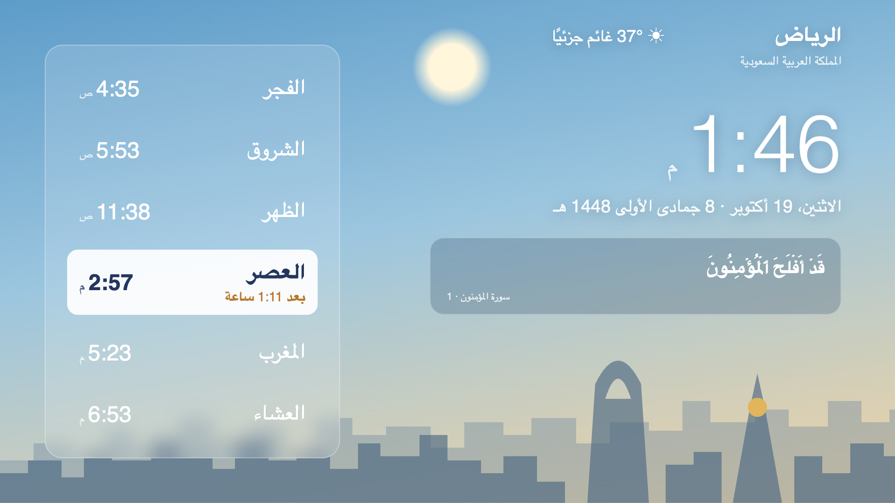
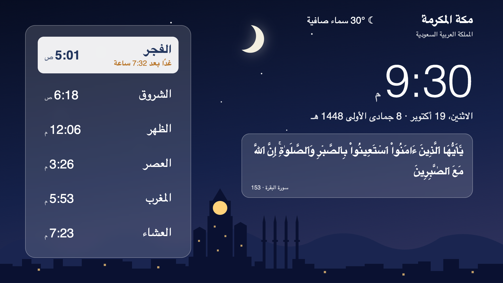

# مواقيت

An Android TV app that turns the screen into a full-screen prayer-times dashboard for a Saudi city. The interface is Arabic and right-to-left.

| Riyadh, by day | Makkah, at night |
| --- | --- |
|  |  |

## What it shows

- The time, plus the Gregorian and Hijri dates.
- The five prayers for today, with Sunrise (الشروق) between Fajr and Dhuhr. The next one is highlighted with a countdown.
- The current weather.
- A short Quran verse that changes every two minutes. The text is the Hafs Uthmani text of the King Fahd Complex edition, checked letter for letter against Tanzil.
- A sky that follows the real day: dawn, day, dusk and night, with the sun, moon and stars. The skyline is Riyadh for Riyadh and Makkah for every other city.

All times are Saudi time (`Asia/Riyadh`), whatever the TV's own time zone is.

## Using it on the TV

The app opens from the TV launcher. Press **OK** on the remote to open the settings menu. Use **Up**/**Down** to move, **OK** to choose, and **Back** to go back or close.

- **المدينة (City).** **تلقائي** (automatic) picks the nearest city from the TV's IP address once a day. You can also pin one of 29 Saudi cities. Outside Saudi Arabia, automatic mode keeps the last city.
- **شاشة التوقف (Screensaver).** Choose **مواقيت** to show the dashboard as the TV's screensaver, or **شاشة Google الأصلية** to go back to the previous one.

Google TV doesn't list third-party screensavers in Settings, so the app sets it directly. That needs a one-time permission per TV, granted over adb:

```sh
adb shell pm grant sa.se.mawaqit android.permission.WRITE_SECURE_SETTINGS
```

The grant survives app updates. Without it, choosing a screensaver only shows a reminder to grant it.

## Offline

The last prayer times (a week ahead) and weather forecast (three days ahead) are saved on the TV. If the internet drops, the screen keeps working from them: prayer times for up to 7 days and weather for up to 48 hours.

## Data sources

- Prayer times: [Aladhan](https://aladhan.com/prayer-times-api), Umm al-Qura method.
- Weather: [Open-Meteo](https://open-meteo.com/).
- City detection: [ipwho.is](https://ipwho.is/), falling back to [ipinfo.io](https://ipinfo.io/).
- Quran text: [Quranpedia](https://quranpedia.net/).

## Repository layout

This repo holds only the app's sources. The build and the signing key are kept outside it on purpose.

| Path | Contents |
| --- | --- |
| `AndroidManifest.xml` | Package `sa.se.mawaqit`, min SDK 23, target SDK 36 |
| `src/sa/se/mawaqit/` | The Java shell: launcher activity, screensaver, WebView host, city list |
| `assets/index.html` | The whole screen: one self-contained HTML file with no external resources |
| `res/drawable-nodpi/` | App icon and TV banner |

## Working on the screen

Open `assets/index.html` in a desktop browser at 16:9 (for example 1920×1080). The clock, dates and sky work on their own. Add `?lat=…&lon=…&city=…` to try another city.

Prayer times and weather appear only when you push data in from the devtools console, the same way the app does:

```js
setData("prayers", JSON.stringify(aladhanResponse))
```

See [CLAUDE.md](CLAUDE.md) for the architecture, the Java-to-page bridge, the refresh schedule and the rules that keep both sides in sync.
